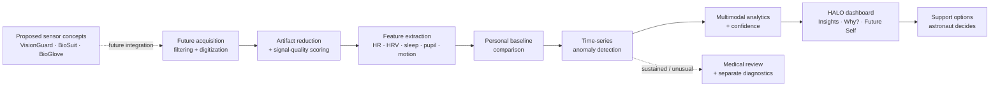

<div align="center">

### HALO-CREW
### A calm, personal wellbeing companion for deep-space missions
*Learns your normal. Notices what changes. Explains why. Lets you decide.*

**NASA Space Apps Challenge:** *Create Health Monitoring Software for Astronauts on Space Missions*
</div>

---
> **Important disclaimer.** HALO Crew is a hackathon concept and design prototype. It is **not** a medical device, does not diagnose any condition, and has not been clinically validated or qualified for spaceflight. All physiological values shown in the app are simulated demo data. The hardware files are engineering *concepts* (geometry only, no firmware or certified electronics). See [Limitations](#limitations-and-honest-scope).

---

## Table of contents

1. [Overview](#overview)
2. [NASA Space Apps Challenge](#nasa-space-apps-challenge)
3. [Design philosophy](#design-philosophy)
4. [Feature tour](#feature-tour)
5. [Tech stack](#tech-stack)
6. [Getting started](#getting-started)
7. [Project structure](#project-structure)
8. [Architecture](#architecture)
9. [Hardware concepts](#hardware-concepts)
10. [Intended data workflow](#intended-data-workflow)
11. [Privacy model](#privacy-model)
12. [Configuration](#configuration)
13. [Scripts and tooling](#scripts-and-tooling)
14. [Customization guide](#customization-guide)
15. [Limitations and honest scope](#limitations-and-honest-scope)
16. [Roadmap](#roadmap)
17. [Team](#team)
18. [References](#references)
19. [License and acknowledgements](#license-and-acknowledgements)

---

## Overview

Long-duration missions (for example a Mars transit of roughly 286 days) put astronauts in an environment with confinement, disrupted sleep, communication delay, and distance from family. Most health dashboards respond with dense, alarm-style numbers. **HALO Crew takes the opposite approach.**

HALO Crew is a **personal-baseline wellbeing companion**. Rather than comparing an astronaut against population averages, it learns each person's own rhythms and highlights only meaningful *changes*, with a plain-language explanation, a confidence level, and a set of low-disruption support options the astronaut can accept or ignore.

The project has two halves:

| Half | What it is | Where it lives |
|---|---|---|
| **Software** | A polished React web app: dashboards, trends, insights, "Why?" explanations, future-self projections, family and crew connection, privacy controls, and an AI Copilot interface | `src/` |
| **Hardware (concept CAD)** | FreeCAD packaging and geometry concepts for VisionGuard eye-monitoring glasses and examination instruments, a BioSuit intravehicular monitoring garment with accessories, and BioGlove sensing-glove presentation models | `Hardware/` |

The demo narrative follows **Commander Maya Chen** on **Mission Day 147 of 286**, mid-transit to Mars aboard *ARES III*.

---
### The problem we addressed
Crewed missions beyond low-Earth orbit mean real-time ground support becomes limited (the demo shows a 2 min 18 sec one-way signal delay at 41.2 million km). Astronauts will need **autonomous, on-board health awareness** that:

- works with a person's *own* physiology instead of generic thresholds,
- surfaces early, subtle trends before they become problems,
- supports mental and social wellbeing, not only physical vitals,
- respects crew privacy in a very small, shared living space, and
- is calm and understandable enough to be used daily under workload.

### How HALO Crew responds

| Challenge need | HALO Crew response |
|---|---|
| Continuous physiological monitoring | Live-vitals panel (heart rate, blood oxygen, HRV) plus 8 trackable metrics (stress, sleep, focus, connection, mood, heart rate, SpO2, HRV) with 7-day trend charts |
| Individualized baselines | **My Personal Model**: radar view of baseline vs. current state, model maturity indicator, "close to your normal" framing |
| Early detection of change | **Insights** feed with confidence and importance ratings; anomaly-style flags such as "Sleep pattern changed" |
| Explainable output | **Why?** page: contributing-factor breakdown (sleep, workload, social rhythm, other), with an explicit "contributing signals, not a diagnosis" disclaimer |
| Proactive support | **Support** recommendations with expected benefit, mission disruption, and a "why HALO recommends this" explanation; **What Works For Me** learns from past outcomes |
| Anticipating trajectories | **Future Self**: 48-hour projections with and without an intervention, with an uncertainty band |
| Psychological wellbeing in isolation | **Family** voice agents and video messages (with signal-delay context), **Crew** wellbeing view, mood check-ins |
| Autonomy under communication delay | "Local mode" and local-first communication; personal processing designed to stay on-board |
| Privacy | Dedicated **Privacy** page with a Private → HALO → Crew-safe data flow and per-item sharing toggles |
| Sensing hardware | Concept CAD for eye-health glasses, a biomedical garment, and a sensor glove, grounded in NASA SANS material |
| Conversational access | **AI Copilot** chat interface (currently mocked, see limitations) |

### Why the hardware is in scope

NASA documents *Spaceflight Associated Neuro-ocular Syndrome (SANS)* as a structural eye risk for long-duration crew. Our VisionGuard concept separates **continuous screening** (eye-tracking glasses with a personal baseline) from **scheduled structural assessment** (OCT, fundus imaging, ultrasound, tonometry as separate instruments), and states clearly that screening is not diagnosis.

---

## Design philosophy

1. **Personal, not generic.** Every number is compared with *your* history.
2. **Calm by default.** Soft palette (lilac, mint, amber), serif display type, gentle motion, no alarm-red dashboards.
3. **Explain, don't alarm.** Every flag comes with a confidence score and a reason.
4. **You stay in control.** HALO recommends; the astronaut decides. Nothing starts without approval.
5. **Private by design.** Detailed signals stay personal; the crew sees only what is necessary.
6. **Context matters.** Mission day, signal delay, and crew rhythm are part of the picture.

---

## Feature tour

The app is a single-page React application with 14 views and a first-run onboarding flow. Navigation is a fixed sidebar (collapsible on mobile), with a mission chip showing *ARES III · TRANSIT · Day 147*.

### Core views

| Page | Route id | What it does |
|---|---|---|
| **Home** | `home` | Hero card with the personal wellbeing ring (score 82, +4% recovery), today's state (stress, sleep, focus, connection) with sparklines, **live biosensor vitals** (heart rate, SpO2, HRV), personal-baseline range, today's insight with confidence, and quick actions (Breathe, Recover, Connect) |
| **My Wellbeing** | `wellbeing` | Tabbed time range (Today / 7 Days / 30 Days / Mission), a metric selector for 8 signals, a trend chart with a dashed baseline reference line, current / 7-day average / change summary, personal-baseline strip, and a mood check-in |
| **Insights** | `insights` | Chronological feed of detected changes, each with a category badge, confidence, importance, and an "Understand why" link; a "HALO is learning your rhythm" model-maturity card |
| **Why?** | `why` | Explanation page with a factor orbit (Sleep 41%, Workload 27%, Social rhythm 18%, Other 14%), and a three-step *What changed / What may be contributing / What can I try* stack |
| **Future Self** | `future` | 48-hour projected-wellbeing chart with an uncertainty band and six switchable interventions (recovery break, family connection, guided breathing, social interaction, music, sleep support) |
| **Support** | `support` | Four personalized recommendations (Recover, Connect, Family, Reset), each with expected benefit, mission disruption, and rationale; a "Try it" modal |

### Connection

| Page | Route id | What it does |
|---|---|---|
| **Family** | `family` | Two tabs. **Family Voice**: three AI voice agents modeled on family members, with a live animated waveform, microphone toggle, and status states. **Family Video**: video messages from Earth with a delay indicator, a player with play/pause, and text or voice replies with reply history |
| **Crew** | `crew` | Crew cards with availability, general wellbeing, and communication openness; crew-health bars; a connection map; a calm "crew support may help later today" suggestion. Shows *general* information only |
| **Mission** | `mission` | Mission-context hero (Earth distance, signal delay), key stats, and a timeline from launch to arrival |

### HALO intelligence

| Page | Route id | What it does |
|---|---|---|
| **AI Copilot** | `copilot` | Full chat UI: welcome state with suggested prompts, message thread, lightweight Markdown renderer (headings, lists, bold/italic, inline and fenced code), thinking indicator, retry on failure, auto-scroll with "stop following when user scrolls up", auto-growing composer (Enter to send, Shift+Enter for newline) |
| **My Personal Model** | `model` | Radar of baseline vs. current across stress, sleep, focus, social, recovery, and mood; model maturity (78%); physical-condition radar (resting HR, SpO2, HRV) |
| **What Works For Me** | `history` | Table of interventions with response label, relative-benefit bar, and last-tried date; summary insight ("connection has been your strongest support") |

### System

| Page | Route id | What it does |
|---|---|---|
| **Privacy** | `privacy` | Private → HALO → Crew-safe flow diagram, three sharing toggles, and the "HALO privacy promise" |
| **Settings** | `settings` | Grouped toggles for wellbeing, privacy, mission, and accessibility, with section navigation that smooth-scrolls |
| **Onboarding** | overlay | Five-slide intro (click the HALO logo to replay), skippable |

### Cross-cutting UX

- **Notification center** with unread badge, per-item read state, and "Mark all read".
- **Dark theme** (the app currently runs in dark mode; light-theme tokens also exist in the CSS).
- **Responsive** layouts at 1100px, 800px, and 540px breakpoints.
- **Accessibility:** skip-to-content link, `aria-label`s on icon buttons, focus-visible outlines, ARIA roles on the thinking indicator, and a `prefers-reduced-motion` override (charts also disable animation when reduced motion is requested).
- **Dynamic document title:** `HaloCrew - <Page>`.

---

## Tech stack

| Layer | Technology |
|---|---|
| UI framework | React 19 + React DOM 19 |
| Build tool | Vite 8 with `@vitejs/plugin-react` 6 |
| Styling | Tailwind CSS v4 via `@tailwindcss/vite`, plus a hand-written design system in `src/index.css` (CSS custom properties, glassmorphism, spring/expo easing) |
| Language | TypeScript (strict mode, `jsx: react-jsx`) |
| Charts | Recharts 3 (area, line, composed, radar charts) |
| Utilities | `clsx`, `tailwind-merge` (`cn()` helper), `tw-animate-css` |
| Fonts | Fraunces (display serif) and Inter (UI), loaded from Google Fonts |
| Icons | Custom inline SVG icon set (no icon library dependency) |
| Formatting | `oxfmt` |
| Package manager | pnpm 10.34.3 |
| Runtime | Node.js 22 (pinned in `.mise.toml`) |
| Hosting context | Built to run inside **Figma Make**, with custom Vite plugins for site config, error-overlay replay, React-refresh fallback, and a component-kit route |
| Hardware CAD | FreeCAD (native `.FCStd`), STEP, GLB, CSV, PNG exports |

---

## Getting started

### Prerequisites

- **Node.js 22** and **pnpm 10.x** (the repo includes a `.mise.toml`; with [mise](https://mise.jdx.dev) installed, run `mise install`).
- *(Optional, hardware only)* **FreeCAD 1.x** to open the CAD files.

### Install and run

```bash
# 1. Clone
git clone <your-repo-url> halocrew
cd halocrew

# 2. Install dependencies
pnpm install --prefer-offline --no-frozen-lockfile

# 3. Start the dev server (default http://localhost:8443)
pnpm dev
```

Open <http://localhost:8443>. The server uses `strictPort`, so if the port is busy it will fail instead of silently picking another one. Change it with `PORT=3000 pnpm dev`.

### Production build

```bash
pnpm build      # outputs to ./dist
pnpm preview    # serves the production build locally
```

### Format

```bash
pnpm format
```

> **Git LFS:** the repository's `.gitattributes` routes images, video, audio, 3D assets, archives, documents, fonts, data/ML files, and CAD formats (`.step`, `.stl`, etc.) through Git LFS. Install it before cloning if you want the CAD exports and images (`git lfs install`).

---

## Project structure

```text
.
├── index.html                  # Vite shell; Figma Make injects lang/title/head/body slots
├── vite.config.ts              # Vite + React + Tailwind v4 + Figma Make plugins, "@" alias → src
├── package.json                # Scripts and dependencies
├── pnpm-lock.yaml
├── tsconfig.json               # Strict TS, "@/*" path alias
├── .mise.toml                  # Node 22, pnpm 10.34.3
├── .gitattributes              # Git LFS rules
├── AGENTS.md / CLAUDE.md       # Guidance for AI coding agents working in this repo
│
├── src/
│   ├── main.tsx                # React entry (StrictMode)
│   ├── App.tsx                 # All pages, shell, navigation, onboarding, notifications
│   ├── charts.tsx              # Recharts wrappers: Spark, Trend, FutureChart, ModelRadar, BodyRadar
│   ├── index.css               # Design tokens, layout, animations, responsive rules, chat styles
│   ├── vite-env.d.ts
│   ├── lib/
│   │   └── utils.ts            # cn() = twMerge(clsx(...))
│   └── components/ui/
│       └── waveform.tsx        # Animated voice waveform used by Family Voice
│
├── Hardware/
│   ├── VisionGuard/            # Eye-health smart glasses + diagnostic instrument concepts
│   │   └── VisionGuard_README.txt
│   ├── BioSuit/                # Full-body biomedical monitoring garment concept
│   │   └── BioSuit_Documentation.md
│   └── BioGlove/               # Sensing glove with labeled presentation models
│       └── LABELS_README.md
│
└── .figma/make/                # Figma Make lifecycle scripts and config
    ├── dev, install, format, deploy, deploy-preview
    ├── analyze-routes, langserver
    ├── dev.json                # Which files trigger install / restart
    └── site.json               # Title, description, robots (noindex), a11y options
```

---

## Architecture

### Application shell

`App` owns global state: the active `page`, mobile-menu state, onboarding visibility, and the notification list. Pages are plain function components selected with a `switch` inside a `useMemo`. There is no router library; navigation is a typed `Page` union and a `navigate()` helper that also closes the mobile menu and scrolls to top.

```text
┌─────────────────────────────────────────────────────────────────┐
│ App                                                             │
│ ├─ Onboarding (overlay, 5 slides)                               │
│ ├─ <aside> Sidebar: brand, mission chip, NAV, settings/privacy  │
│ └─ .app-main                                                    │
│    ├─ <header>: local-mode chip, mission day, notifications,    │
│    │            profile                                         │
│    └─ <main id="main"> → one of 14 pages                        │
└─────────────────────────────────────────────────────────────────┘
```

### Shared UI primitives (in `App.tsx`)

`Icon` (inline SVG icon set, 36+ icons), `Button` (primary / secondary / ghost), `Card`, `Badge` (good / info / attention / neutral), `PageHead`, `Ring` (animated wellbeing ring), `Toggle`.

### Charts (`src/charts.tsx`)

| Export | Used for |
|---|---|
| `Spark` | Mini area sparklines on metric cards |
| `Trend` + `metricSummary` | Wellbeing trend chart with baseline reference line and summary stats for 8 metrics |
| `FutureChart` | 48-hour projection: with-support vs. without-change lines and an uncertainty band; `lift` offsets per intervention |
| `ModelRadar` / `BodyRadar` | Baseline vs. current radars (wellbeing model and physical signals) |

All charts respect `prefers-reduced-motion` and share a custom tooltip (`Tip`).

### AI Copilot flow

```text
User message ──► send() ──► optimistic user bubble
                    │
                    └─► thinking = true ──► mockAiRespond() (2 s timer)
                                                 │
                         assistant message ◄─────┘   (error ► failed bubble + Retry)
```

`renderMarkdown` / `renderInline` render a safe subset of Markdown (no `dangerouslySetInnerHTML`). The model call is isolated in `mockAiRespond()` so a real backend can replace it in one place.

### Design system (`src/index.css`)

CSS custom properties define surfaces, text, lines, and accent colors; `.app.dark` overrides them. Motion uses three shared easing curves (`--spring`, `--ease-expo`, `--ease`) and a staggered "rise" entrance choreography. A secondary block of shadcn-style tokens (`--background`, `--primary`, …) powers Tailwind utilities used by `components/ui/waveform.tsx`.

### Figma Make integration (`vite.config.ts`)

| Plugin | Purpose |
|---|---|
| `figmaSiteConfiguration` | Applies `.figma/make/site.json` (title, description, favicon, social image, robots, analytics, custom scripts, bypass link) to the HTML shell and emits `robots.txt` |
| `figmaErrorOverlayReplay` | Replays the latest Vite build error to clients that connect late (dev only) |
| `figmaReactRefreshBoundaryFallback` | Forces a full reload when a module loses its React Refresh boundary (dev only) |
| `figmaMakeKitPlugin` | Serves `/.figma/make/kit.html` that exposes `*.stories.*` modules for the design surface (dev only) |

---

## Hardware concepts

The hardware folder contains engineering concept models, not connected devices. FreeCAD files preserve editable geometry and component groupings; STEP/GLB exports and renders support inspection and presentation. Some models include parameterized dimensions and metadata, but none includes deployed electronics, firmware, validated sensing, or a connection to this web app. Read each linked hardware guide for its detailed scope and limitations.

### VisionGuard: eye-health glasses and instruments

*Read: `Hardware/VisionGuard/VisionGuard_README.txt`*

- **Wearable glasses concept:** models two inward-facing IR camera packages, recessed IR emitter packages, an IMU, processor and power-board envelopes, display/coupler, environmental sensor packages, antenna, battery envelope, frame and serviceable parts. These are geometry representations; the model does not acquire pupil, blink, or other signals. The electronics make the frame about 150 mm wide (nominal temple length 145 mm).
- **Separate examination concepts:** OCT and fundus camera enclosures, a manual refractive test, ocular ultrasound probe/console, rebound tonometer, and a visual-test station. These are separate supported instruments, not sensors built into or carried by the glasses. The modeled packages do not establish diagnostic performance or calibration.
- **Editability and files:** lens and selected housing dimensions are editable in the mixed parametric model; many detailed solids are generated from macro recipes. The folder includes native FreeCAD, STEP and GLB exports, macros, renders, inventory/validation files, and documentation.

### BioSuit: biomedical monitoring garment

*Read: `Hardware/BioSuit/BioSuit_Documentation.md`*

An intravehicular (not EVA) garment geometry concept. The model includes component envelopes and contacts for the following proposed sensing functions; it is not an operational suit or sensor system:

| Assembly | Intended output |
|---|---|
| Cardiovascular | ECG/rhythm, HR/HRV, peripheral pulse trends |
| Respiratory | Movement, rate, pattern, impedance |
| Temperature | Local skin and ambient temperature |
| Surface EMG | Local muscle activation trends |
| Motion | Segment orientation, activity, joint movement |
| Sweat | Exploratory local Na+/Cl- monitoring |
| Autonomic | EDA and stress-associated trends |
| Dosimetry | Personal exposure logging |
| Environment | Local temperature/RH, pressure, CO2, optional O2 |
| Gloves / Insoles | Proposed peripheral PPG/SpO2 trends, hand motion, contact force, pressure zones |
| VisionGuard | Proposed pupil/blink/eye-motion monitoring; see the separate concept and limitations above |
| ECU / power | Packaging envelopes for proposed synchronized acquisition and onboard analytics; no deployed electronics or firmware |

Plus a modeled off-body **medical accessory rack** with concepts for a blood-pressure cuff, capnography, telemetric core-temperature capsule, sleep-study EEG/EOG, and an ocular diagnostic docking plate. The docking plate is only a plate, locating pins, and data/power port; it is not an OCT or other diagnostic instrument. Resizing is driven by a 15-parameter spreadsheet, with manual fit and interference checks still needed.

### BioGlove: labeled presentation models

*Read: `Hardware/BioGlove/LABELS_README.md`*

Three annotated presentation files (**Dorsal**, **Palm**, **Electronics**) with native arrow-and-text callouts linked to source components, plus `add_bioglove_labels.FCMacro` to apply labels to an edited model. These are presentation views of provisional component envelopes, not a completed glove circuit or validated sensor.

### Opening the CAD

1. Install FreeCAD, then open the relevant `.FCStd` file.
2. Press `0` for isometric view, `V` then `F` to fit.
3. Use the included view/configuration macros (**Macro → Macros → Execute**) for exploded, transparent, annotated, and orbit views.
4. Use the STEP files in other CAD tools and the GLB files in web renderers (meters, Y-up). GLB does not keep parametric history.

---

## Intended data workflow

This is a proposed end-to-end pipeline, not an implemented hardware-to-software connection. The web app currently implements dashboard views using simulated data; no sensor acquisition, filtering, signal processing, or hardware interface is delivered.



Key principle: **screening is not diagnosis.** Wearable trends can prompt scheduled, validated clinical assessment; they do not replace it.

---

## Privacy model

HALO Crew uses a three-tier model, illustrated on the **Privacy** page:

| Tier | Contents | Who sees it |
|---|---|---|
| **Private** | Sleep, mood, stress, detailed personal patterns | The astronaut |
| **HALO (secure personal processing)** | The personal model, learned locally | On-device processing only |
| **Crew-safe** | General availability, necessary safety information | Crew and, with consent, the medical team |

Commitments shown in the UI: no private psychological scores shown to crew, no raw internal IDs or labels, safety alerts carry only necessary information, and sharing can be reviewed at any time. Per-item toggles cover sharing with the medical team, family recommendations, and crew support suggestions.

> These controls are currently **UI-level demonstrations**. No data leaves the browser, because no data is collected.

---

## Configuration

### Environment variables

| Variable | Default | Purpose |
|---|---|---|
| `PORT` | `8443` | Dev and preview server port |
| `FIGMA_DEV_SERVER_HOST` | `0.0.0.0` | Dev and preview host |
| `FIGMA_PUBLIC_URL` | *(unset)* | If set, used as the Vite `base` path for deployed builds |

### Site metadata: `.figma/make/site.json`

```json
{
  "description": "HALO is an autonomous health-monitoring platform for astronauts...",
  "robots": { "index": false },
  "accessibility": { "addBypassLinks": false, "ignoreReducedMotion": false }
}
```

`robots.index: false` adds `noindex, nofollow` and serves a disallow-all `robots.txt`. Remove or flip it once you want the demo to be publicly indexed.

### Build modes

`.figma/make/deploy-preview` builds with `--mode development`, which emits inline sourcemaps and skips minification. A normal `pnpm build` is minified without sourcemaps.

---

## Scripts and tooling

| Command | Description |
|---|---|
| `pnpm dev` | Start Vite dev server with HMR |
| `pnpm build` | Production build to `dist/` |
| `pnpm preview` | Serve the built output |
| `pnpm format` | Format with `oxfmt` |

`.figma/make/` contains wrapper scripts used by Figma Make (`install`, `dev`, `format`, `deploy`, `deploy-preview`, `analyze-routes`, `langserver`). `dev.json` restarts install/dev only when `package.json` or `pnpm-lock.yaml` change; normal source edits are handled by Vite HMR.

---

## Customization guide

**Add a new page**

1. Add its id to the `Page` union and `PAGE_TITLES` in `src/App.tsx`.
2. Add an entry to `NAV` (and a new `IconName` / path if you need an icon).
3. Create the page component and add a `case` in the `switch` inside `App`.

**Change the demo astronaut or mission**

Search `App.tsx` for `Maya`, `ARES III`, `Day 147`, and `286`; the Mission page and Family page also hold crew, family, and distance data.

**Swap simulated data for real data**

Chart series live in `src/charts.tsx` (`TREND_SETS`, `MODEL`, `BODY`, the rows in `FutureChart`) and inline arrays in `Home`, `Insights`, `Support`, `Crew`, and `History`. Replace these with values from your data layer.

**Connect a real AI model to Copilot**

Replace `mockAiRespond()` in `App.tsx` with a call to your backend (streaming recommended). The component already handles loading, failure, retry, and Markdown rendering. Keep API keys on a server; never ship them in client code.

**Change the look**

Edit the CSS variables at the top of `src/index.css` (`--teal`, `--amber`, `--surface`, …) and the `.app.dark` override block. Display and body fonts are set in the Google Fonts `@import` and the `Fraunces` / `Inter` references.

---

## Limitations and honest scope

- **Simulated data.** All vitals, trends, insights, projections, and model-maturity values are hard-coded demo content.
- **Mock Copilot.** The AI Copilot returns a fixed greeting after a 2-second delay; no model is connected.
- **Family voice and video are demos.** The waveform animation is generated, not driven by audio, and videos are placeholder players.
- **No backend, authentication, or persistence.** State resets on reload.
- **Not clinically validated.** No diagnostic claims are made; "Why?" factors are illustrative contributing signals.
- **Hardware is geometry only.** The CAD documentation explicitly states that no firmware, electrical schematics, optical ray-tracing, eye-safety assessment, thermal analysis, EMC, biocompatibility, or flight qualification is provided, and that no NASA approval or affiliation is claimed.
- **Dark mode is fixed** (`const dark = true` in `App`); a theme toggle is not wired up.
- **Type-checking is not part of the build.** Vite does not type-check, and there is no `typecheck` script yet. Running `tsc --noEmit` will likely surface a few strictness issues (for example, the `FAMILY_VIDEOS` tuple is typed as four strings but contains a boolean).
- **Lockfile drift.** `pnpm-lock.yaml` predates some dependencies in `package.json` (such as `recharts`, `clsx`, `tailwind-merge`, `tw-animate-css`); the install script uses `--no-frozen-lockfile` and will regenerate it.

---

## Roadmap

- [ ] Replace mock data with a time-series store and a simulated sensor stream
- [ ] Implement baseline learning and change detection (for example rolling z-scores or EWMA, then learned models) with uncertainty reporting
- [ ] Connect Copilot to a real LLM with grounded access to the user's own trends
- [ ] Real voice and video pipeline with delay-tolerant (store-and-forward) messaging
- [ ] Offline-first / local-first PWA mode
- [ ] Role-based views: astronaut, crew, flight surgeon, with audited consent
- [ ] Light/dark theme toggle and a full accessibility audit (WCAG 2.1 AA)
- [ ] Add `typecheck` and lint scripts, plus CI
- [ ] Unit and component tests; Storybook stories (the Vite config already supports `*.stories.*`)
- [ ] Wire hardware concepts to a software sensor simulator
- [ ] Add a `LICENSE` file

---

## Team

| Name | Role |
|---|---|
| `<!-- TODO -->` | `<!-- TODO -->` |

---

## References

- NASA, *Spaceflight Associated Neuro-ocular Syndrome (SANS): 2023 Clinical Update*: <https://ntrs.nasa.gov/citations/20220014606>
- NASA OCHMO, *Medical Technical Brief: SANS* (21 Feb 2024): <https://www.nasa.gov/wp-content/uploads/2024/02/ochmo-mtb-001-sans.pdf>
- NASA, *Risk of Spaceflight Associated Neuro-ocular Syndrome*: <https://www.nasa.gov/reference/risk-of-spaceflight-associated-neuro-ocular-syndrome-sans/>
- NASA, *ISS Research Keeps an Eye on Vision Changes in Space*: <https://www.nasa.gov/humans-in-space/international-space-station-research-keeps-an-eye-on-vision-changes-in-space/>
- NASA NTRS, *Lunar Health Monitor*: <https://ntrs.nasa.gov/citations/20160005394>
- NASA Space Apps Challenge: <https://www.spaceappschallenge.org>

These sources informed the choice of monitoring and assessment modalities. They do not endorse HALO Crew or validate any modeled device.

---

## License and acknowledgements

`<!-- TODO: add a LICENSE file and state it here -->`

Built for the **NASA International Space Apps Challenge**. This project is not affiliated with, endorsed by, or approved by NASA. Earth imagery on the Mission page is loaded from Unsplash; please check its license terms before redistributing.

<div align="center">

*Wellbeing, quietly watched over. Distance, made a little smaller.*

</div>
